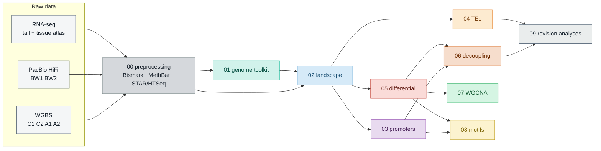

<div align="center">

# DNA methylation landscape during tail regeneration in the garden slug *Deroceras laeve*

**Analysis code and supplementary data for the manuscript**


</div>

---

We profiled the CpG methylome of the tail of *D. laeve* before and 2 days after amputation by whole-genome bisulfite
sequencing (two pools per condition), compared it with tail RNA-seq and a 40-library coexpression network, and checked it
against a PacBio HiFi native methylome of the body wall. *D. laeve* lacks DNMT3; the code here asks how methylation is
organised in such a genome, what amputation changes, and whether those changes follow transcription.

## Pipeline



## Modules

| Module | What it does | Paper figures |
|---|---|---|
|  | Job scripts that turned raw reads into the pipeline inputs (documentation only) | — |
|  | Genome CpG composition, CpG depletion across five mollusks, the DNA methylation toolkit, tail differential expression, and the JASPAR → *D. laeve* motif library | Fig. 1ACD, Fig. S1, Fig. S2, Fig. S11B, Fig. S14, Fig. S15 |
|  | The baseline methylome: global level, genomic compartments, gene-body methylation vs expression, TSS metagenes, HiFi vs WGBS agreement | Fig. 2A, Fig. 3ABC, Fig. S3A, Fig. S4, Fig. S5, Fig. S6 |
|  | Weber promoter classes in *D. laeve* and human, promoter methylation and expression, GO/KEGG by class | Fig. 4ABC, Fig. 5BC, Fig. S7AB, Fig. S17 |
|  | Transposable element methylation by class, location and age (HiFi bodywall; WGBS tail in the supplement) | Fig. 6ABC, Fig. S9ABC |
|  | DSS DMPs and DMRs, their annotation, region enrichment, GO/KEGG, label-swap null | Fig. 7ABCD, Fig. 8A, Fig. S11A |
|  | Methylation change vs expression change; DMR tracks | Fig. S10ABCD, Fig. S12ABCDE |
|  | Coexpression modules of 40 tissue libraries and where methylation change concentrates | Fig. 9AB, Fig. S13 |
|  | UMR/LMR segmentation and TF motif enrichment (monaLisa, HOMER) | Fig. 5A, Fig. 10AB, Fig. S8AB, Fig. S16 |
|  | Analyses added in the co-author review: Fig. 1B/1E/2B redrawn, false-positive and platform-vs-tissue tests, rolling genome profile | Fig. 1BE, Fig. 2B, Fig. S3B |

Each module reads raw data and lower-numbered modules only, and writes only inside its own folder
(`data/`, `objects/`, `figures/main/`, `figures/supplementary/`). The panel-by-panel map is in
[`docs/FIGURES.md`](docs/FIGURES.md) and the methods, module by module, in [`docs/METHODS.md`](docs/METHODS.md).

## Run

R 4.4.1 / Bioconductor 3.20; package versions in [`environment/`](environment/). External tools (BLAST+, HMMER, DIAMOND,
MAFFT, trimAl, IQ-TREE, HOMER) are called from the scripts with `system2()`. Set the ALL-CAPS path constants at the top
of each script and the `cd` line of each launcher to your layout, then submit the modules in order:

```bash
for m in 01_genome_toolkit 02_landscape 03_promoters 04_TEs 05_differential \
         06_decoupling 07_wgcna 08_motifs 09_revision_analyses; do
  sbatch $m/code/$m.slurm      # wait for each module before submitting the next
done
```

Without Slurm: `Rscript NN_name/code/NN_name.R` in the same order (threads from `SLURM_CPUS_PER_TASK`).
Slow steps are cached under `objects/`, so reruns are short.

**Conventions**

- `set.seed(20260426)` is the first statement of every script.
- Every analysis is restricted to `chr1`–`chr31` plus the mitochondrial scaffold.
- Every statistical test is marked in the code with `# STAT TEST:`.
- Figures are written as `.pdf`, `.png` and `.svg` with the same stem.

## Supplementary data

| File | Content |
|---|---|
| [`Data_S1`](supp_data/Data_S1_human_promoter_class_GO_KEGG.tsv) | GO and KEGG overrepresentation for human promoter CpG classes |
| [`Data_S2`](supp_data/Data_S2_WGCNA_sweep_and_length_adjusted_enrichment.xlsx) | WGCNA parameter sweep and length-adjusted module enrichment |
| [`Data_S3`](supp_data/Data_S3_DMP_DMR_GO_KEGG_by_direction.xlsx) | GO and KEGG overrepresentation for DMP and DMR genes, by direction of change |
| [`Data_S4`](supp_data/Data_S4_JASPAR_motif_to_Dlaeve_assignment.xlsx) | JASPAR motif to *D. laeve* gene assignment |
| [`Data_S5`](supp_data/Data_S5_promoter_class_methylation.tsv) | Promoter CpG class, methylation state and expression per gene |

Sources of every sheet are listed in [`supp_data/README.md`](supp_data/README.md).

## Data availability

Raw WGBS, RNA-seq and PacBio HiFi reads: NCBI SRA (BioProject in the manuscript). The genome assembly and its annotation
are described in Miranda-Rodríguez *et al.* (2025) *G3* 15:jkaf164, [doi:10.1093/g3journal/jkaf164](https://doi.org/10.1093/g3journal/jkaf164).

## Citation

If you use this code, please cite the manuscript (see [`CITATION.cff`](CITATION.cff)):

> Lopez-Tellez R, Gutiérrez-Sarmiento W, Trejo-Arellano MS, Brito-Domínguez DA, Varela-Echavarría A,
> Miranda-Rodríguez JR. DNA methylation landscape during tail regeneration in the garden slug *Deroceras laeve*.
> In preparation.

Instituto de Neurobiología, UNAM (Querétaro, Mexico) · Institute of Science and Technology Austria.
Corresponding authors: avarela@unam.mx, jerol@comunidad.unam.mx.
